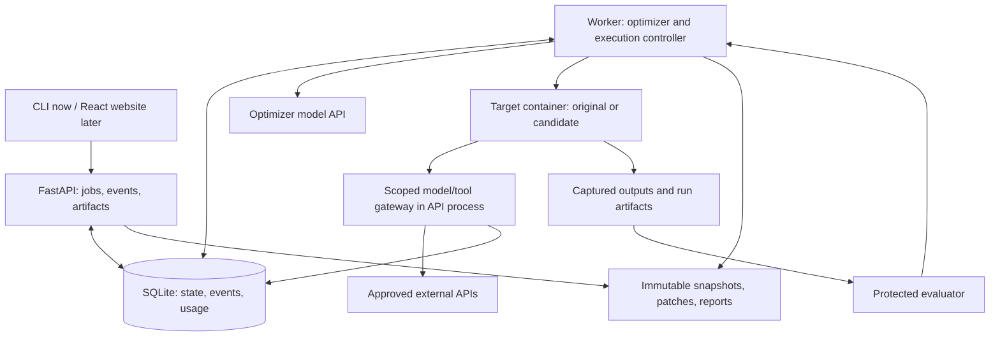

# Architecture: Autonomous Agent Optimization Engineer

Status: architecture plan, October 10, 2026. All 37 backend regression tests passed; local authentication startup and real GitHub sign-in succeeded. GitHub source-import tests use mocks; real App/repository access and Google sign-in remain unverified. Setup and storage contracts are in [README.md](README.md) and [GITHUB_IMPORT.md](GITHUB_IMPORT.md). Source import uses one in-process worker and a persisted SQLite queue and never executes source. The optimizer, execution boundary, hosted integrations, and performance claims remain unverified. This document follows [prd.md](prd.md); [SPONSORS.md](SPONSORS.md) defines sponsor roles and AWS restrictions.

## Stack and deployment

Use Python for the API, optimizer, execution controller, and evaluation. Start with FastAPI, Pydantic validation, the selected provider's SDK, and pytest. Use uv for a project environment and lockfile. Propose Python 3.12 for the controller; verify the selected dependencies before pinning. Target repositories execute in an approved image matching their declared runtime rather than inheriting the controller environment.

Use React, TypeScript, and Vite for the later frontend. The first interface can be an API client or CLI. A responsive API, durable events, and independent worker matter more initially than UI styling or language benchmarks.

Deploy one API process and one worker process on one approved EC2 host, with one active job and one target container at a time. Store SQLite and artifact files on durable local storage. No distributed queue is needed for this scope.



## User contract and automatic setup

User input: permitted repository/revision, a representative task, optimization goal, behavioral requirements, and experiment limit. Missing model/tool access is requested only when it blocks execution. The user does not write our adapter or tracing integration.

The optimizer inspects README files, dependencies, configuration, and entrypoints. It proposes an execution recipe and creates the JSON-input/result adapter. The controller validates paths, commands, runtime, and dependency choices before execution. Validate the adapter against the original invocation so an adapter bug is not reported as an agent defect.

Initial local and hosted execution supports reviewed Python workflows and approved dependency images. Repositories outside that boundary receive a specific setup blocker. Automatic onboarding is the goal; arbitrary public repository execution is not established by this draft. Builds and dependency installation must never execute submitted code in the API or worker environment.

## The autonomous decision loop

Use one tool-using model loop with an explicit tool dispatcher. The model chooses source inspections, hypotheses, edits, experiments, and follow-up actions. Conventional code controls permission checks, budget admission, subprocess execution, persistence, and acceptance.

Initial tools: `inspect_source`, `read_run`, `create_candidate`, `run_experiment`, `compare`, and `finish`. Discovery uses bounded inspection and approved execution recipes, rather than unrestricted host shell access. File tools validate resolved paths and symlinks; patches are limited to declared editable files.

Persist concise hypotheses, actions, results, and open questions. Retrieve relevant source and run records as needed rather than accumulating every log in model context. Store observable decision summaries, not private model reasoning.

Each candidate has an immutable source snapshot, parent revision, and patch. The target executes from that snapshot in a separate workspace; the optimizer cannot edit a running experiment. Rejecting a candidate selects an earlier snapshot. Reset tool/test state between runs; source rollback does not undo external side effects.

## Execution and accounting boundaries

Run targets as non-root processes with CPU, RAM, process-count, output-size, and wall-time limits. Allow only job workspace mounts; exclude controller credentials, evaluator files, ledger, other jobs, and Docker socket. Validate networking and runtime enforcement before hosting even reviewed workflows. Containers share the host kernel and do not constitute a validated arbitrary-code service.

For the first provider integration, configure the supported target client to use our gateway. Provider credentials stay outside the candidate. The gateway validates scoped job access, permitted model/tool, request size, call limits, and maximum output. Restrict direct external network access to prevent bypass. Transparent compatibility with every SDK is not assumed.

Account for both optimizer calls and target calls in the same job ceiling, with separate categories. Reserve maximum estimated expense atomically before dispatch, including the permitted output allowance; reconcile provider usage afterward. Unknown usage or ambiguous completion remains unresolved and conservatively reserved. Stop admitting calls when limits are exhausted. A provider's already-dispatched call cannot be assumed cancelled or refunded.

Measure elapsed workflow time, model calls, tokens, estimated expense, tool calls, failures, and container memory use. Instrument context construction and agent memory access separately: machine RAM and conversational memory are different measurements. Neatlogs provides trace evidence; the protected ledger owns accounting.

## Independent evaluation

Define acceptance before editing. Expose development cases and their diagnostics to the optimizer. Freeze the selected candidate before protected final cases; exclude their labels from candidate mounts and optimizer tools. Final feedback must not drive another edit while remaining labeled independent.

Compare original and candidate on identical cases with declared model settings, tools, cache policy, and reset state. Include failures and retries. Use exact checks for bounded outputs; semantic checks require an explicit calibrated rubric. Generated tests can support exploration, but cannot alone establish preserved behavior.

Report per-case outcomes, cost and latency tradeoffs, optimization expense, and limitations. Compute break-even usage only for positive savings on comparable successful work. Preserve the original, rejected patches, and an honest no-improvement result.

## State, API, and recovery

Persist jobs, candidates, runs, events, and usage reservations in SQLite. Use short transactions and WAL on local storage; both processes use their own connections. The worker claims queued work transactionally and records phase transitions. Initial states: `queued`, `discovering`, `needs_input`, `baselining`, `experimenting`, `final_check`, `completed`, `no_improvement`, `failed`, and `cancelled`.

API surface: create a job, get its status/report, fetch events after an event ID, request cancellation, and download artifacts. Later, stream persisted events over server-sent events with reconnect support. Browser disconnects do not own job lifetime.

Use a separate worker instead of an in-memory HTTP background task for long experiments. Record intended external actions before dispatch and outcomes afterward. On restart, reconcile interrupted runs and unresolved expense before admitting further work; do not blindly replay calls that may have completed. Automatic continuation is conditional on recovered state, not an exactly-once guarantee.

## Suggested module layout

```text
backend/
  app/
    api.py         # validated endpoints and event delivery
    store.py       # jobs, events, runs, usage reservations
    worker.py      # job lifecycle and recovery
    optimizer.py   # model loop and bounded tool dispatch
    runner.py      # approved execution recipes and containers
    gateway.py     # scoped provider/tool requests and accounting
    evaluation.py  # protected checks and comparison
  tests/
examples/          # supported target and development tasks
frontend/          # React/TypeScript, added after the loop works
var/               # ignored runtime DB, workspaces, artifacts
```

Protected final fixtures belong outside target and optimizer access. The example target is chosen for a real measurable bottleneck, not manufactured waste. Before coding, establish Git and Entire capture; preserve the existing AGENTS.md. Use Neatlogs during implementation and produce CFO.ai economics from measured records.

## First implementation slice

1. Select a runnable target and requirements; validate its original behavior.
2. Build execution capture, protected checks, and a durable run record. Verify limits, malformed inputs, timeouts, and failed calls.
3. Establish bounded provider access and real baseline accounting once credentials and a numerical budget exist.
4. Let the optimizer inspect, edit, rerun, respond to feedback, and export one verified patch or rejection.
5. Add job endpoints, restart/cancellation checks, then the website and live events.

Remaining decisions: target workflow, model provider/access, cash budget, safe gateway networking, and evaluation cases. Python, Node, uv, and the Docker CLI are present locally; Docker daemon access and runtime enforcement have not been tested. Git and Entire are initialized, with an Entire origin remote configured. Checkpoint uploads are disabled; hooks need approval and no initial commit/checkpoint has been recorded. Authentication dependencies are declared in `pyproject.toml`; execution remains deferred.

## References checked for this draft

- [FastAPI concurrency](https://fastapi.tiangolo.com/async/) and [background tasks](https://fastapi.tiangolo.com/tutorial/background-tasks/).
- [SQLite WAL](https://sqlite.org/wal.html): same-host processes, concurrent readers, and one writer at a time.
- [Vite getting started](https://vite.dev/guide/).
- [Docker resource limits](https://docs.docker.com/engine/containers/resource_constraints/) and [security](https://docs.docker.com/engine/security/), checked earlier in this session.
