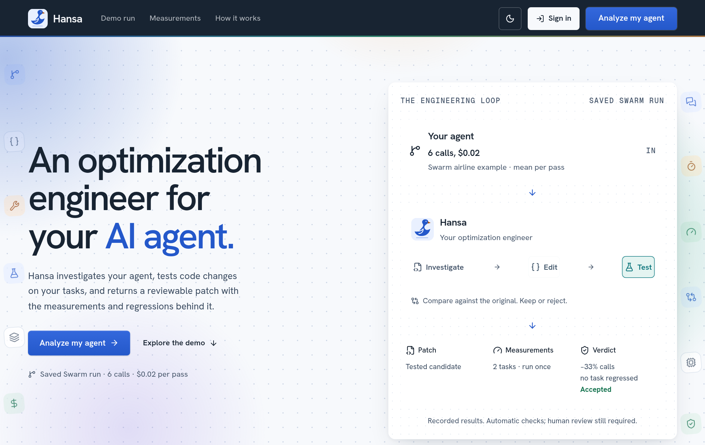
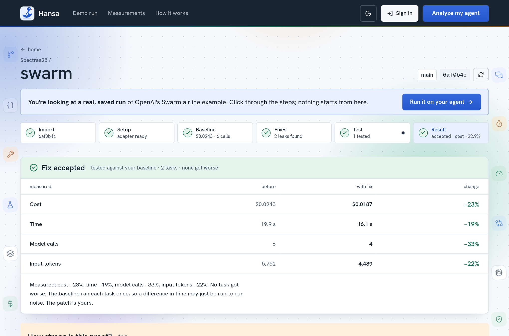

<p align="center">
  
</p>

<h1 align="center">Hansa</h1>

<p align="center"><b>An optimization engineer for your AI agent.</b></p>

<p align="center">
  <a href="https://hansa.sverma.online"><b>Live site</b></a> ·
  <a href="https://hansa.sverma.online/demo">Recorded run</a> ·
  <a href="https://hansa.sverma.online/judges">Evidence for each claim</a> ·
  <a href="https://cfo.ai/s/fG9t075-Bd4KFAHP">Business model</a>
</p>

<p align="center">
  
  
  
  
  
  
  
  
  
</p>

<p align="center"></p>

Hansa was built for **neatHack 2026** by [@sonuv_dev](https://x.com/sonuv_dev), team Spectra.

## The problem

An AI agent has many parts: prompts, tools, memory, context and a model. Each part can make the agent slow, expensive or unreliable. To find the cause, you need an engineer who measures the agent and reads its code.

## What Hansa does

Hansa does the work of that engineer. It measures your agent, examines each part, and tests a fix. It gives you the fix only if the agent still gives the same answers.

## What Hansa examines

| Area | What Hansa looks for |
| --- | --- |
| **Prompt and context** | Text that the agent sends again on each call. A system prompt that is too large. |
| **Memory** | Data that the agent keeps between turns but does not use. A history that only grows. |
| **Tools** | Tool definitions that go with each call but are not used. The same tool call made two times. |
| **Agent design** | A step that only passes the request to a different agent. Loops that have no limit. |
| **Model choice** | A large model that does a simple job. |
| **Caching** | A stable part of the prompt that the provider can cache. |
| **Output** | Answers that are longer than the next step needs. |
| **Speed** | Calls that run one after the other but can run at the same time. |
| **Reliability** | No limit on turns or on answer length. A change that makes a task fail. |

## The steps

1. **Import.** Select a GitHub repository. Hansa copies one commit. The copy is read-only.
2. **Onboard.** The Hansa agent reads the code. It writes a small adapter that runs your agent.
3. **Baseline.** Hansa runs your tasks in a sandbox. It records each model call, its cost and its time.
4. **Find.** Hansa shows where the cost goes. It gives each finding with a file and a line.
5. **Test.** Hansa changes a private copy and runs the same tasks again.
6. **Result.** You get a patch, the measurements, and a brief for your coding agent.

<p align="center"></p>

## Results

These results are from real agents. The checks are automatic. A person did not examine the answers.

So far, the fixes that Hansa tested changed the agent design. Hansa also reports findings in the other areas. For caching and model choice it gives an estimate, because the sandbox cannot measure them.

| Agent | Result |
| --- | --- |
| OpenAI Swarm, airline example | Hansa predicted 14.8% less cost. It measured **13.3% less cost and 22.7% fewer model calls** on 8 tasks. No task failed. Hansa accepted the fix. |
| OpenAI Swarm, earlier run | A fix removed 10% of the model calls, but one task failed. Hansa **rejected** the fix. |
| OpenAI Agents SDK, customer service example | A fix changed nothing. Hansa reported **no improvement**. |

## How it works

- **The model proposes. Code decides.** Hansa calculates the result from the measurements. The model cannot accept its own fix.
- **Your code runs in a sandbox.** The sandbox has no network of its own and no keys.
- **Each number comes from a recorded call.** Hansa records each model call in its gateway.

Hansa cannot measure some changes in the sandbox. Examples are a different model and prompt caching. For these changes, Hansa gives an estimate and labels it as an estimate.

## Tools

| Tool | Use |
| --- | --- |
| **Neatlogs** | Hansa records each sandbox run and each agent job as a trace. The app shows these traces. Hansa also reads the Neatlogs detections as leads. |
| **Entire** | Entire holds the repository and the recorded agent sessions for the commits. |
| **CFO.ai** | CFO.ai holds the business model. The model uses the measured costs. |
| **AWS EC2** | One server runs the API, the sandbox and the database. |
| **Vercel** | Vercel hosts the web interface. |
| **Python, FastAPI, SQLite** | The API, the agent and the data. |
| **Docker** | The sandbox for imported code. |
| **React, TypeScript, Vite, Tailwind CSS** | The web interface. |

For screenshots and one full incident, see [docs/SPONSOR_TOOLS.md](docs/SPONSOR_TOOLS.md).

## Run Hansa

The easiest method is the [live site](https://hansa.sverma.online). The [recorded run](https://hansa.sverma.online/demo) needs no account.

To run Hansa on your computer, you need Python 3.12, [uv](https://docs.astral.sh/uv/), Node 20 and Docker.

```sh
# Start the API
cd backend
uv sync --locked
uv run uvicorn app.main:create_app --factory --host 127.0.0.1 --port 8000 --no-access-log

# Start the web interface in a second terminal
cd frontend
npm install
npm run dev

# Run the tests
cd backend && uv run pytest
```

Put your settings in a `.env` file at the top of the repository. Use [backend/.env.example](backend/.env.example) as the template. For more instructions, see [backend/docs/SETUP.md](backend/docs/SETUP.md).

## Folders

| Folder | Contents |
| --- | --- |
| `backend/` | The API, the Hansa agent, the sandbox and the tests |
| `frontend/` | The web interface |
| `deploy/` | The server setup |
| `docs/` | Screenshots and the sponsor tool page |

## Limits

- The proof is only as good as the tasks. Most results use 2 to 8 tasks.
- Hansa supports Python agents that use the OpenAI chat format.
- Hansa runs one job at a time.
- The costs come from the model provider. They are not compared with an invoice.

## Credits

Hansa was built with [Neatlogs](https://neatlogs.com), [Entire](https://entire.io) and [CFO.ai](https://cfo.ai). It was tested on the OpenAI [Swarm](https://github.com/openai/swarm) and [Agents SDK](https://github.com/openai/openai-agents-python) examples.
