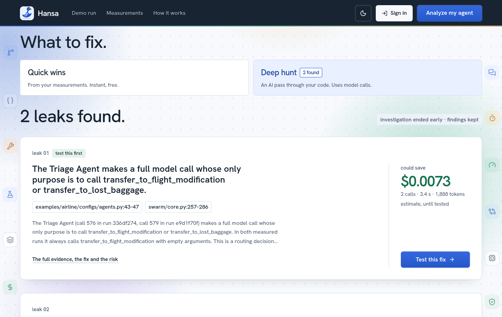
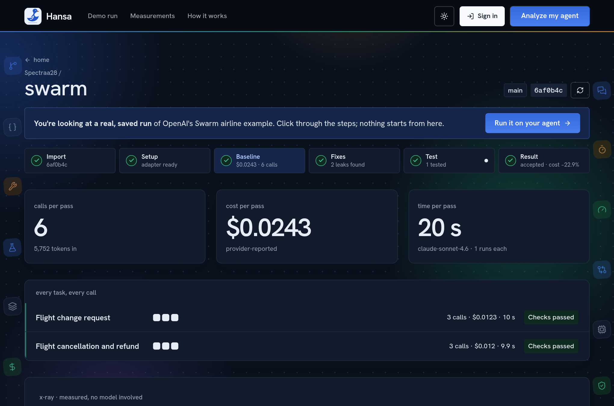

<p align="center">
  
</p>

<h1 align="center">Hansa</h1>

<p align="center"><b>An optimization engineer for your AI agent.</b><br>
It runs your agent on your own tasks, measures every model call, finds what is wasted,<br>and hands you a tested fix, or tells you plainly that it could not prove one.</p>

<p align="center">
  <a href="https://hansa.sverma.online"><b>Live site</b></a> ·
  <a href="https://hansa.sverma.online/demo">Recorded run</a> ·
  <a href="https://hansa.sverma.online/judges">Every claim, with its evidence</a> ·
  <a href="https://cfo.ai/s/fG9t075-Bd4KFAHP">Business model</a>
</p>

<p align="center">
  
  
  
  
  
  
  
  
  <br>
  
  
  
  
  
  
</p>

<p align="center"></p>

Built solo for **neatHack 2026** by [@sonuv_dev](https://x.com/sonuv_dev) (team Spectra).

## The problem

An agent makes model calls its owner never sees. Some resend the same context every step. Some only pass a request from one agent to the next. Each one costs money and time, and none of it shows up until the bill does.

Tools that point at the waste are common. What is hard is changing the agent and knowing its behaviour did not change with it.

## What Hansa does

1. **Import.** Pick a GitHub repository and branch. Hansa copies one commit, read-only.
2. **Onboard.** Hansa's own agent reads the code, writes a small adapter so the agent can be run as a batch program, and proves it with a real run.
3. **Baseline.** Your tasks run in a sandbox. Every model call is counted, timed and priced.
4. **Find.** Quick wins come free from the measurements. A deeper pass reads the runs and the source and reports each finding with file and line.
5. **Test.** A fix is made on a private copy and the same tasks are rerun. Plain code, not the model, decides whether anything regressed and whether the saving is real.
6. **Take it.** A patch against your exact commit, a brief for your own coding agent, and the measurements behind both.

<p align="center"></p>

## What it has measured

All of this is from real runs on other people's agents. The checks are automatic; a person has not confirmed the answers.

| Agent | What happened |
| --- | --- |
| **OpenAI Swarm**, airline example, hosted server | The deep hunt predicted −14.8% cost from removing an agent that only routes. The fix test measured **−13.3% cost, −22.7% model calls, −16.5% time** across 8 tasks, none regressed. Accepted. |
| **OpenAI Swarm**, earlier run | A fix saved 10% of model calls and made one passing task fail. Hansa **rejected it** and kept the evidence. |
| **OpenAI Agents SDK**, customer-service example | The same kind of fix measured 0% change. Hansa finished it as **no improvement**. |

Some changes cannot be shown by rerunning tasks in the sandbox: a model swap, prompt caching, a safety guard. Hansa does not test those. It gives an estimate from the measured baseline and list prices, labelled as an estimate.

<p align="center"></p>

## How it is built

```
            ┌──────────────────── your browser ────────────────────┐
            │  React app on Vercel   (hansa.sverma.online)          │
            └───────────────┬───────────────────────────────────────┘
                            │  /auth, /github  (passed through by Vercel)
            ┌───────────────▼───────────────────────────────────────┐
            │  FastAPI on one EC2 host, behind Caddy (HTTPS)        │
            │                                                       │
            │  GitHub import ──► inspection ──► task contract       │
            │                                                       │
            │  Hansa's agent ── onboarding · deep hunt · fix test   │
            │        │  tools: read, search, edit, run, measure     │
            │        ▼                                              │
            │  Docker sandbox ──► model gateway ──► model provider  │
            │  (no network of     (throwaway key,                   │
            │   its own, no keys)  spend cap, every call recorded)  │
            │        │                                              │
            │        ▼                                              │
            │  call ledger (SQLite) ──► X-ray, comparison, verdict  │
            │        └──────────────► Neatlogs traces               │
            └───────────────────────────────────────────────────────┘
```

Three ideas hold it together:

- **The model proposes; code decides.** Whether a task regressed, whether a saving clears the bar and whether a fix is accepted are computed from the ledger. A saving under 5% is not accepted when run-to-run variation was not measured.
- **Imported code never touches the host.** It runs in a container with a read-only copy of its own snapshot, no network of its own, memory and process limits, and one throwaway key that can only reach Hansa's gateway.
- **Every number has a call behind it.** Cost, tokens and timing come from the gateway's record of each call, not from the agent's own report.

## The tools, and how each is used

### Sponsor tools

| Tool | How Hansa uses it |
| --- | --- |
| **[Neatlogs](https://neatlogs.com)** | Part of the product. Every sandbox run and every agent job is logged as a trace through the Neatlogs MCP server, then read back to confirm it arrived. The trace window in the app shows each step from Neatlogs beside Hansa's own per-call figures. The investigator also reads Neatlogs' detections as leads. 337 traces in the project so far. Known gap: Neatlogs' cost total reads $0 because Hansa sends cost in its own field. |
| **[Entire](https://entire.io)** | The project's home. Entire is the git remote, and agent coding sessions (Codex) were recorded as checkpoints alongside the commits they produced. 10 of the first 25 commits carry one. No product feature depends on Entire. |
| **[CFO.ai](https://cfo.ai)** | The business model, built from measured unit costs: Starter $149 a month for one proof, Team $299 for three, with the customer paying their own model bill. It includes a hosted stress case that loses money. [Open the model](https://cfo.ai/s/fG9t075-Bd4KFAHP). No customer has paid yet. |
| **AWS** | One `t3.medium` EC2 instance in `us-east-1` runs the API, the sandbox and the database, inside the hackathon's limits. |

#### Neatlogs in practice

<p align="center"></p>

- **What gets logged.** One trace per sandbox run (each model call as a step, the gaps between calls, and any outside connection) and one per agent job (each model call and each tool the agent used). 337 so far.
- **How it is used in the product.** After logging, Hansa reads each trace back to confirm it arrived. The trace window shows Neatlogs' steps and timing beside Hansa's own figures for each call. During a deep hunt, the investigator reads Neatlogs' detections for a run as leads, then checks them against the recorded calls and the source.
- **How it was used while building.** The digest above is where failed runs showed up: the error rate rose from 0.6% to 6.3% as deep hunts failed on their own tool steps. Reading those traces is what pointed at the steps that needed fixing.
- **About the $0.00.** The amber box in the image is our note, not Neatlogs'. Neatlogs prices a trace from its model name and token counts, and Hansa was logging a short model name it could not price. Recorded spend for the build is $13.30. Traces from 12 October onward use a name Neatlogs can price; its figure is list price, so it will differ from what the provider charged.

#### An incident, start to finish: onboarding the OpenAI Agents SDK example

Three runs of the same job on the same agent, all traced.

| When | Result | Model calls | Cost | Sandbox runs |
| --- | --- | --- | --- | --- |
| 11 Oct, 21:12 | **Failed** at the 40-turn limit | 40 | $0.475 | 2, both crashed |
| 11 Oct, 21:24 | **Ready** | 18 | $0.233 | 1, passed |
| 12 Oct, 08:03 | **Ready**, through a provider timeout | 18 | $0.195 | 1, passed |

**What went wrong.** Hansa's model gateway refused the SDK's requests because they carried fields it did not recognise, with a message that pointed the agent the wrong way. It spent all 40 turns on workarounds.

**What changed.** The gateway now drops fields it does not forward instead of refusing the request, and the onboarding prompt tells the agent to switch such frameworks to plain chat completions rather than patch the client. Twelve minutes later the same job finished in 18 calls at half the cost.

**The next morning** the first model call of the same job timed out after a minute. Neatlogs flags it as a slow response and a failed execution. The job retried and still finished; earlier in the build a timeout like that ended a deep hunt outright.

<p align="center"></p>

"Content withheld" in these traces is Hansa's own fallback: when Neatlogs' ingest refuses a trace's full text, Hansa resends it with timings and token counts and no content.

### Backend

| Tool | Used for |
| --- | --- |
| **Python 3.12, FastAPI, Uvicorn** | The API, the agent loops and the runner, as one process. |
| **SQLite** | Accounts, imports, task contracts, the call ledger, jobs and results. One file, backed up nightly on the server. |
| **Docker** | The sandbox. A fresh set of containers per run, with dependencies installed offline from pinned, hashed wheels. Old images are pruned after each build. |
| **httpx** | The model gateway's calls to the provider, and GitHub's API. |
| **Authlib, joserfc, pwdlib (Argon2), cryptography** | GitHub and Google sign-in, GitHub App tokens (encrypted at rest), and password login. |
| **LiteLLM gateway (hosted)** | The model provider Hansa's own gateway forwards to. Claude Sonnet 4.6 runs Hansa's agent. |
| **pytest** | 297 tests, including real Docker lifecycle checks. |

### Frontend

| Tool | Used for |
| --- | --- |
| **React 19, TypeScript, Vite** | The interface. |
| **Tailwind CSS 4** | Styling, with a small set of shared colour tokens for the light and dark themes. |
| **TanStack Query** | Fetching and the live run feed, which keeps going through dropped requests. |
| **React Router** | Pages. |
| **Lenis** | Smoothed scrolling, loaded after first paint. |
| **lucide-react** | Icons. |
| **Vercel** | Hosting, and passing `/auth` and `/github` through to the API so the browser talks to one address. |

### Hosting

**Caddy** terminates HTTPS on the server and exposes only `/auth` and `/github`. **systemd** keeps the one API process running. See [deploy/README.md](deploy/README.md).

<p align="center"></p>

## Run it yourself

The quickest way is the [live site](https://hansa.sverma.online): sign in with GitHub or Google and import an agent. The [recorded run](https://hansa.sverma.online/demo) needs no sign-in and spends nothing.

To run it locally you need Python 3.12, [uv](https://docs.astral.sh/uv/), Node 20 or later, and Docker.

```sh
# API
cd backend
uv sync --locked
uv run uvicorn app.main:create_app --factory --host 127.0.0.1 --port 8000 --no-access-log

# Interface, in a second terminal
cd frontend
npm install
npm run dev          # http://localhost:5173

# Tests
cd backend && uv run pytest
```

Settings go in a `.env` file at the repository root; copy [backend/.env.example](backend/.env.example) and fill it in. [backend/docs/SETUP.md](backend/docs/SETUP.md) covers sign-in providers, the GitHub App and the model gateway.

## Repository layout

```
backend/app/agent/       Hansa's agent: onboarding, deep hunt, fix test, estimates, prompts
backend/app/gateway/     metered model gateway: throwaway keys, spend caps, the call ledger
backend/app/runner/      Docker sandbox, baselines, the X-ray, the comparison and verdict
backend/app/tracing/     Neatlogs client and trace read-back
backend/app/github/      GitHub App connection and fixed-commit import
backend/app/contracts/   task contracts and their checks
backend/docs/            a document for each backend stage
backend/tests/           the test suite
frontend/src/            the interface
deploy/                  server setup, HTTPS config, publish script
```

## Known limits

- Proof is only as strong as the tasks. Most results rest on 2 to 8 tasks run once, and Hansa rates that itself.
- Python agents only, speaking the OpenAI chat-completions format, non-streaming.
- Agents with heavy dependencies (PyTorch, browsers) or provider-hosted tools cannot run in the sandbox yet.
- One job runs at a time. A second request is refused with what is running, not queued.
- Model swaps, caching and guards are estimated, not measured.
- Costs are the figures the provider reported per call, not reconciled against an invoice.

## Credits

Built for neatHack 2026 with [Neatlogs](https://neatlogs.com), [Entire](https://entire.io) and [CFO.ai](https://cfo.ai). Tested on OpenAI's [Swarm](https://github.com/openai/swarm) and [Agents SDK](https://github.com/openai/openai-agents-python) examples. Typeface: Hanken Grotesk.
