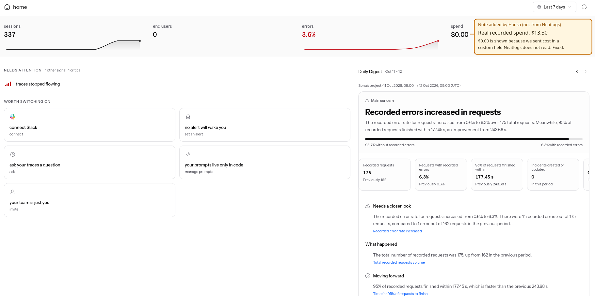
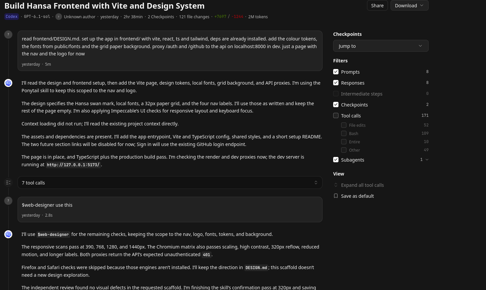
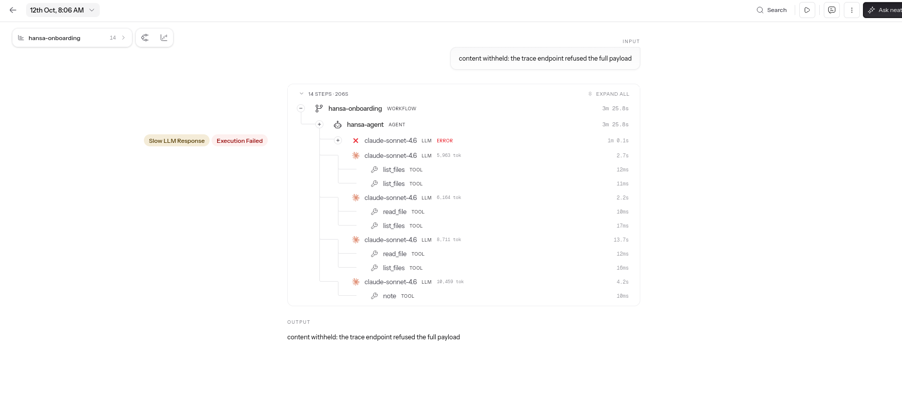
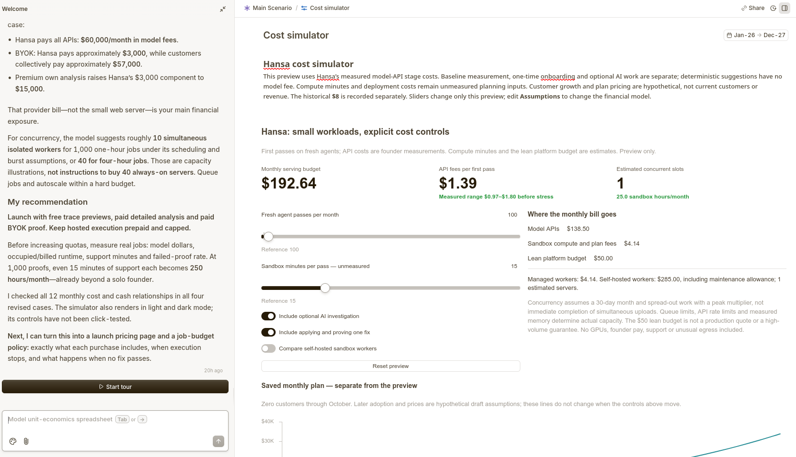

# How Hansa uses the sponsor tools

This page shows how Neatlogs, Entire and CFO.ai were used. It has a screenshot of each tool and one incident from start to finish.

## Neatlogs in practice

- **What gets logged.** One trace per sandbox run (each model call as a step, the gaps between calls, and any outside connection) and one per agent job (each model call and each tool the agent used). 337 so far.
- **How it is used in the product.** After logging, Hansa reads each trace back to confirm it arrived. The trace window shows Neatlogs' steps and timing beside Hansa's own figures for each call. During a deep hunt, the investigator reads Neatlogs' detections for a run as leads, then checks them against the recorded calls and the source.
- **How it was used while building.** The digest above is where failed runs showed up: the error rate rose from 0.6% to 6.3% as deep hunts failed on their own tool steps. Reading those traces is what pointed at the steps that needed fixing.
- **About the $0.00.** The amber box in the image is our note, not Neatlogs'. Neatlogs prices a trace from its model name and token counts, and Hansa was logging a short model name it could not price. Recorded spend for the build is $13.30. Traces from 12 October onward use a name Neatlogs can price; its figure is list price, so it will differ from what the provider charged.

## Entire in practice

- **What it holds.** The project's git repository lives on Entire, and so do the agent sessions behind it. The image is one of them: a Codex session that scaffolded the frontend, kept with its prompts, the agent's replies, 171 tool calls and the two checkpoints it produced.
- **How it was used.** Coding moved between agents during the build. A checkpoint ties a commit to the session that wrote it, so the next session could be pointed at why a file looks the way it does, not only at what it contains. That is the "helped with providing context" in the launch post.
- **What it covers.** 11 checkpoints, on 10 of the first 25 commits. Entire is set up to capture Codex sessions, so commits from other sessions carry none.
- **What it is not.** Hansa the product does not call Entire. It is how Hansa was built.

### Checkpoints

The repository on Entire is public. Each checkpoint below is recorded on the commit beside it.

| Checkpoint ID | Commit | Session started with |
| --- | --- | --- |
| `01M4Q7V56FYRKNC5AC9MS7BX8X` | `1894e6e` | "Lets start frontend of the hansa" |
| `01M4PXBTBBCKSPRFWRMZP5G5TF` | `8cec1f6` | "Lets start frontend of the hansa" |
| `01M4N648YE33Y5BPN8XPQWGNZD` | `6482f84` | "read frontend/DESIGN.md. set up the app in frontend/ with..." |
| `01M4N35AY96GEDE8WMBSBFA538` | `e0f515f` | "read frontend/DESIGN.md. set up the app in frontend/ with..." |

To see all of them, run `entire checkpoint list` in a clone of the repository.

## An incident, start to finish: onboarding the OpenAI Agents SDK example

Three runs of the same job on the same agent, all traced.

| When | Result | Model calls | Cost | Sandbox runs |
| --- | --- | --- | --- | --- |
| 11 Oct, 21:12 | **Failed** at the 40-turn limit | 40 | $0.475 | 2, both crashed |
| 11 Oct, 21:24 | **Ready** | 18 | $0.233 | 1, passed |
| 12 Oct, 08:03 | **Ready**, through a provider timeout | 18 | $0.195 | 1, passed |

**What went wrong.** Hansa's model gateway refused the SDK's requests because they carried fields it did not recognise, with a message that pointed the agent the wrong way. It spent all 40 turns on workarounds.

**What changed.** The gateway now drops fields it does not forward instead of refusing the request, and the onboarding prompt tells the agent to switch such frameworks to plain chat completions rather than patch the client. Twelve minutes later the same job finished in 18 calls at half the cost.

**The next morning** the first model call of the same job timed out after a minute. Neatlogs flags it as a slow response and a failed execution. The job retried and still finished; earlier in the build a timeout like that ended a deep hunt outright.

"Content withheld" in these traces is Hansa's own fallback: when Neatlogs' ingest refuses a trace's full text, Hansa resends it with timings and token counts and no content.

## CFO.ai in practice

- **What it holds.** The business model for Hansa: prices, costs for each proof, a 12-month forecast and three scenarios. [Open the model](https://cfo.ai/s/fG9t075-Bd4KFAHP).
- **How it was used.** The model starts from measured costs. A full first pass on a small agent costs $0.97 to $1.80 in model fees. That range comes from the runs in this repository.
- **What it showed.** The model provider bill is the main cost, not the server. If Hansa pays for all model calls at 1,000 agents a month, the bill is about $60,000. If the customer uses their own key, Hansa pays about $3,000.
- **The decision it led to.** The customer pays their own model bill. Hansa charges a software fee: $149 a month for one proof, or $299 for three.
- **What is not measured.** Sandbox minutes, customer growth and plan prices are assumptions. No customer has paid.
